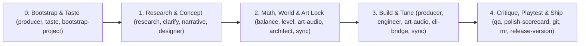

# Studio Skills — Master Roadmap

**Version:** `1.0.0` | **Released:** `2026-11-21`

Fast-scan navigation map for all studio skills. Agents read this index to compose the exact skills needed for a task without bulk-loading unrelated files.

## 3-Cluster Composition Formula

```text
Active Task Skills = [General Rules Touched] + [Active Studio Role(s)] + [Project Engine/Genre Specialists]
```

| Cluster | Path | Purpose | Roadmap |
|---|---|---|---|
| **1. General** | `general/*` | Universal rules enforced across **every** role whenever touching that activity | [general/README.md](general/README.md) |
| **2. Roles** | `roles/*` | Department-specific craft, deliverables, and write boundaries (`01..06`, Code, QA, Producer) | [roles/README.md](roles/README.md) |
| **3. Specialist** | `Projects/<game>/.agent/skills/*` | Per-game Engine (`godot-*`, `unity-*`, `unreal-*`, `web-*`) & Genre (`rpg`, `card-game`, `puzzle`...) | `Projects/<game>/.agent/skills/README.md` |

## End-to-End Game Production Flow



## Quick Lookup: Which Skill Owns What?

- **Behavioral boundaries & evidence honesty** -> [`general/guardrails`](general/guardrails/SKILL.md)
- **Keeping GDD, `registry.yaml`, `data/`, Code, `MOC.md` & GitHub in sync** -> [`general/sync`](general/sync/SKILL.md) (`node .agent/tools/check-sync.mjs`)
- **Director preferences (`DIRECTOR_PROFILE.md`) & game soul (`STYLE_ANCHOR.md`)** -> [`general/taste`](general/taste/SKILL.md) ([`workflows/distill-taste.md`](../workflows/distill-taste.md))
- **Resolving open gameplay/scope/architecture decisions** -> [`general/clarify`](general/clarify/SKILL.md)
- **Single-branch Git, staging safety, Conventional Commits & SemVer** -> [`general/git`](general/git/SKILL.md) (`node .agent/tools/inspect-staging.mjs`)
- **Merge Request / Pull Request template (`Name`, `Agent`, file-level `Description`)** -> [`general/mr`](general/mr/SKILL.md) (`node .agent/tools/gh-studio.mjs mr-create`)
- **1-line code comments, `status: draft|locked`, clean `data/` tables** -> [`general/hygiene`](general/hygiene/SKILL.md)
- **MCP tools & on-demand JSON CLI bridges (Blender, Krita, Godot, RenderDoc)** -> [`general/cli-bridge`](general/cli-bridge/SKILL.md)
- **Point `1–5` scoring, GitHub Project board & subagent orchestration** -> [`roles/producer`](roles/producer/SKILL.md) ([`workflows/parallel-dispatch.md`](../workflows/parallel-dispatch.md))
- **Department craft (`research`, `narrative`, `designer`, `balance`, `level`, `art-audio`, `architect`, `engineer`, `qa`)** -> [`roles/README.md`](roles/README.md)
