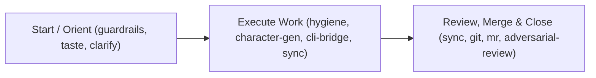

# General Skills Cluster — Roadmap

**Version:** `1.0.0` | **Released:** `2026-11-21`

Universal rules that apply **regardless of which Studio Role you hold**. Load only the general skill(s) matching the operation you are performing.

## Task Lifecycle Roadmap

## Catalog (`10` Skills)

| Skill | Version | Trigger — Load When... | Companion Tool / Workflow |
|---|---|---|---|
| [`guardrails`](guardrails/SKILL.md) | `1.1.0` | Setting up session boundaries, language split, Producer routing, or evidence gates | [`PREFLIGHT.md`](../../PREFLIGHT.md) |
| [`sync`](sync/SKILL.md) | `1.0.0` | Creating or changing any mechanic, stat, entity, schema, timing, code behavior, or status | `node .agent/tools/check-sync.mjs` |
| [`taste`](taste/SKILL.md) | `1.0.0` | Aligning output with Director taste / `STYLE_ANCHOR.md`, or recording a user correction | [`workflows/distill-taste.md`](../../workflows/distill-taste.md) |
| [`clarify`](clarify/SKILL.md) | `1.1.0` | Running upfront project/feature discovery interviews & High-Level Overview Plan sign-off | [`workflows/overview-plan.md`](../../workflows/overview-plan.md) |
| [`character-gen`](character-gen/SKILL.md) | `1.0.0` | Sourcing open web character rigs + animations or generating `1 -> 10..20` multi-angle Face & Body sheets via Nano Banana | [`workflows/multi-view-character.md`](../../workflows/multi-view-character.md) |
| [`git`](git/SKILL.md) | `1.0.0` | Creating a branch, staging files, writing a Conventional Commit, pushing, or cutting SemVer | `node .agent/tools/inspect-staging.mjs` & [`workflows/release-version.md`](../../workflows/release-version.md) |
| [`mr`](mr/SKILL.md) | `1.1.0` | Opening, reviewing, or auto-merging a Merge Request / Pull Request (`Name`, `Agent` + model, file-by-file `Description`) | `node .agent/tools/gh-studio.mjs mr-create` / `mr-merge` |
| [`adversarial-review`](adversarial-review/SKILL.md) | `1.0.0` | Validating a finished branch/MR in a fresh isolated review session (auto-merge on `clean`, escalate after `3–4` fails) | `node .agent/tools/gh-studio.mjs comment` / `mr-merge` |
| [`hygiene`](hygiene/SKILL.md) | `1.1.0` | Enforcing 1-line English comments, `data/` schemas, substantive Vietnamese `departments/` docs, & `draft\|locked` headers | — |
| [`cli-bridge`](cli-bridge/SKILL.md) | `1.0.0` | Calling project MCPs or bridging GUI DCC/profiling apps (Blender, Krita, Audacity, RenderDoc) via JSON CLI | `node .agent/tools/gh-studio.mjs` |
