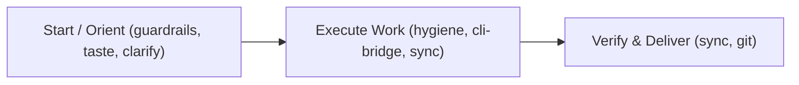

# General Skills Cluster — Roadmap

**Version:** `1.0.0` | **Released:** `2026-11-21`

Universal rules that apply **regardless of which Studio Role you hold**. Load only the general skill(s) matching the operation you are performing.

## Task Lifecycle Roadmap

## Catalog (`7` Skills)

| Skill | Version | Trigger — Load When... | Companion Tool / Workflow |
|---|---|---|---|
| [`guardrails`](guardrails/SKILL.md) | `1.0.0` | Setting up session boundaries, evaluating risk, or verifying evidence gates | [`PREFLIGHT.md`](../../PREFLIGHT.md) |
| [`sync`](sync/SKILL.md) | `1.0.0` | Creating or changing any mechanic, stat, entity, schema, timing, code behavior, or status | `node .agent/tools/check-sync.mjs` |
| [`taste`](taste/SKILL.md) | `1.0.0` | Aligning output with Director taste / `STYLE_ANCHOR.md`, or recording a user correction | [`workflows/distill-taste.md`](../../workflows/distill-taste.md) |
| [`clarify`](clarify/SKILL.md) | `1.0.0` | A material gameplay, scope, canon, or architecture decision remains unresolved after inspection | — |
| [`git`](git/SKILL.md) | `1.0.0` | Creating a branch, staging files, writing a Conventional Commit, pushing, or cutting SemVer | `node .agent/tools/inspect-staging.mjs` & [`workflows/release-version.md`](../../workflows/release-version.md) |
| [`hygiene`](hygiene/SKILL.md) | `1.0.0` | Writing/reviewing inline code comments, `data/` schemas, relative doc links, or `draft\|locked` headers | — |
| [`cli-bridge`](cli-bridge/SKILL.md) | `1.0.0` | Calling project MCPs or bridging GUI DCC/profiling apps (Blender, Krita, Audacity, RenderDoc) via JSON CLI | `node .agent/tools/gh-studio.mjs` |
