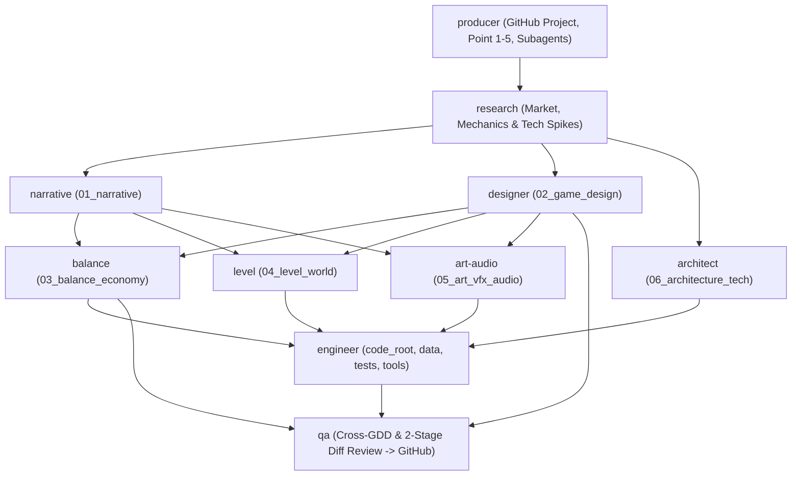

# Studio Roles Cluster — Department Roadmap

**Version:** `1.0.0` | **Released:** `2026-11-21`

Department playbooks mapped 1-to-1 to a real Game Studio. Pick the role(s) matching the assignment. Write isolation is enforced by [`hooks/write-guard.mjs`](../../hooks/write-guard.mjs).

## Cross-Department Collaboration & Handoff Map

## Role Catalog & Write Ownership (`10` Roles)

| Role Skill | Version | Allowed Write Scope | Core Deliverable |
|---|---|---|---|
| [`producer`](producer/SKILL.md) | `1.0.0` | GitHub Project/Issues/Milestones + `departments/MOC.md` | Scope guard, `C/I/F/V` point scoring, Context Packets, parallel crew supervision |
| [`research`](research/SKILL.md) | `1.0.0` | GitHub Issue comments (or caller's department draft) | Reference game deconstruction, mechanic pattern trade-offs, technical spikes |
| [`narrative`](narrative/SKILL.md) | `1.0.0` | `departments/01_narrative/**`, `data/dialogue/**`, `data/localization/**` | World lore, 4-layer characters, Relation Tree, branching flags & dialogue |
| [`designer`](designer/SKILL.md) | `1.0.0` | `departments/02_game_design/**`, `departments/registry.yaml` | `game-brief.md`, system GDDs by `rigor`, trade-off rules, 3-phase action choreography |
| [`balance`](balance/SKILL.md) | `1.0.0` | `departments/03_balance_economy/**`, `departments/registry.yaml`, `data/balance/**`, `tools/simulators/**` | Math curves, economy sinks/faucets, 3-tier RNG, executable `.mjs` simulations |
| [`level`](level/SKILL.md) | `1.0.0` | `departments/04_level_world/**`, `data/levels/**` | Encounter pacing, spatial layout, progression gating & soft-lock verification |
| [`art-audio`](art-audio/SKILL.md) | `1.0.0` | `departments/05_art_vfx_audio/**`, `<asset_root>/**`, `assets_source/**` | Art Bible, Hero Target -> Asset Family, Audio Bus, non-sim Juice & blind polish scoring |
| [`architect`](architect/SKILL.md) | `1.0.0` | `departments/06_architecture_tech/**`, shared schemas, `PROJECT.md` | DDD vs Data-Driven choice, engine roots, versioned saves, 60 FPS budget, Scene Lock |
| [`engineer`](engineer/SKILL.md) | `1.0.0` | `<code_root>/**`, `data/**`, `prototypes/**`, `tests/**`, `tools/**` | Data-driven implementation, 3-layer bug diagnosis, pure-logic TDD & CLI playtest harness |
| [`qa`](qa/SKILL.md) | `1.0.0` | GitHub Issue/PR comments *(strictly read-only on local repo)* | Cross-GDD conflict scan, 2-stage adversarial diff review, playtest checklists |
