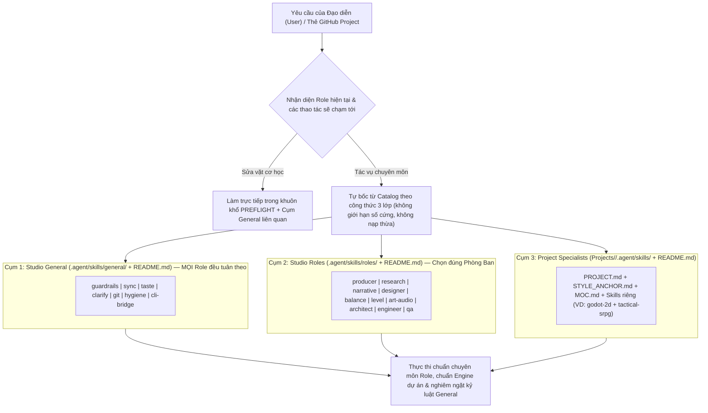
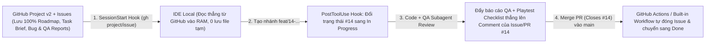
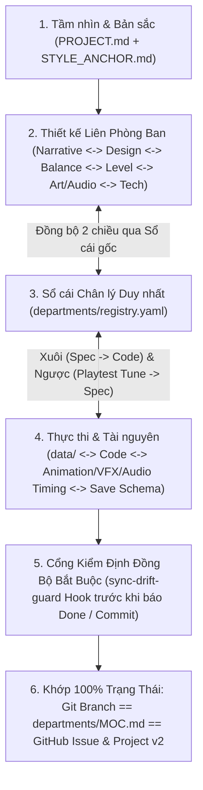

# Game Studio Workspace — Master Architecture & Workflow Blueprint (v2)

> **Mục tiêu tài liệu:** Đặc tả kiến trúc chuẩn cho **Games Studio Workspace** — vận hành một studio làm game chuyên nghiệp bằng hệ thống AI Agents đa phòng ban, **độc lập với thể loại (genre-agnostic)** và **độc lập với công nghệ/engine (engine-agnostic)**.
>
> **6 Nguyên tắc thiết kế cốt lõi (Core Philosophy):**
> 1. **Tự do trong khuôn khổ (Rule-Bounded Autonomy):** Không ép Agent chạy theo một chuỗi bước máy móc cố định; Agent tự chọn đường đi ngắn nhất và hợp lý nhất miễn tuyệt đối không vượt qua các hàng rào quy định (Guardrails).
> 2. **Tự chọn kỹ năng theo Role từ Catalog (Need-Driven Catalog Picking):** Không bao giờ nạp tràn lan toàn bộ kho skill, và cũng **không áp trần số lượng cứng** — Agent tự nhận diện vai trò hiện tại, tra cứu Catalog chung + riêng và nạp đủ mọi skill thực sự cần thiết cho công việc đó.
> 3. **Khóa quyền ghi theo phòng ban (Department Write Isolation):** Phân vùng quyền tạo/sửa file chặt chẽ theo từng phòng ban, cưỡng chế bằng cả quy tắc lẫn **Lifecycle Hooks (`PreToolUse`)**.
> 4. **Điều phối Sub-Agent theo thang Point `1–5` hiện đại hoá:** Kế thừa công thức chấm điểm rủi ro `Point = max(C, I, F, V)` quen thuộc nhưng cập nhật sang hệ sinh thái Agent thế hệ mới (`research`, `browser`, `image-generator`, Custom Role Agents, `swarm`, Worktrees).
> 5. **Công thức ghép kỹ năng 2 tầng (`Common Role Skill + Project Specialist Skill + Project Map`):** Mỗi game có bản đồ (`MOC.md`) và bộ skill chuyên biệt riêng cho Engine + Phong cách game đó; khi làm việc Agent kết hợp kỷ luật phòng ban chung của Studio với kỹ năng đặc thù của dự án.
> 6. **Luật Đồng Bộ Tuyệt Đối Toàn Chuỗi + Giao việc qua GitHub Projects & Thấm nhuần "Gu" Đạo diễn:** Bắt buộc đồng bộ hai chiều xuyên suốt mọi khâu làm game (*Vision $\leftrightarrow$ Narrative $\leftrightarrow$ Design $\leftrightarrow$ Balance $\leftrightarrow$ Data $\leftrightarrow$ Code $\leftrightarrow$ Art/VFX/Audio $\leftrightarrow$ QA $\leftrightarrow$ GitHub Board*), kết hợp học sát phong cách cá nhân của chủ Studio (`DIRECTOR_PROFILE.md`) và bản sắc dự án (`STYLE_ANCHOR.md`).

---

## Mục Lục

1. [Đúc Kết & Sàng Lọc Thẳng Tay Từ 9 Bộ Reference Trending](#1-đúc-kết--sàng-lọc-thẳng-tay-từ-9-bộ-reference-trending)
2. [Kiến Trúc Tự Do Trong Khuôn Khổ & Cơ Chế Tự Chọn Skill (`Common + Project`)](#2-kiến-trúc-tự-do-trong-khuôn-khổ--cơ-chế-tự-chọn-skill-common--project)
3. [Cây Thư Mục Phòng Ban, Bản Đồ Tri Thức (`MOC.md`) & Hook Giới Hạn Quyền Edit File](#3-cây-thư-mục-phòng-ban-bản-đồ-tri-thức-mocmd--hook-giới-hạn-quyền-edit-file)
4. [Hệ Thống Chấm Point `1–5` (`C/I/F/V`), Trần Quyền Hạn & Điều Phối Dàn Agent Mới](#4-hệ-thống-chấm-point-15-cifv-trần-quyền-hạn--điều-phối-dàn-agent-mới)
5. [Quản Trị Work 100% Trên GitHub (Không Cần Webhook Server Riêng) & Git 1 Nhánh Standard Version](#5-quản-trị-work-100-trên-github-không-cần-webhook-server-riêng--git-1-nhánh-standard-version)
6. [Đồng Bộ Xuyên Suốt, Học "Gu" Đạo Diễn (`Distilly` + `Instincts`) & Cầu Nối Công Cụ (`CLI-Anything`)](#6-đồng-bộ-xuyên-suốt-học-gu-đạo-diễn-distilly--instincts--cầu-nối-công-cụ-cli-anything)
7. [Quy Chuẩn Viết Skill, Ngôn Ngữ Tool Duy Nhất & Cấu Trúc Cụm `General` vs `Roles`](#7-quy-chuẩn-viết-skill-ngôn-ngữ-tool-duy-nhất--cấu-trúc-cụm-general-vs-roles)

---

## 1. Đúc Kết & Sàng Lọc Thẳng Tay Từ 9 Bộ Reference Trending

Toàn bộ **9 kho mã nguồn trending** đã được kéo về cục bộ trong `../References/repos/` (đã cấu hình git-ignore). Theo đúng nguyên tắc **"chỉ chưng cất cơ chế thực chiến đắt giá, thẳng tay loại bỏ sự phình to theo phong trào"**, dưới đây là bảng phân tích mổ xẻ từng bộ:

| Nguồn tham khảo (`References/repos/`) | Cơ chế đắt giá đưa vào Studio | Điểm lược bỏ để giữ sự linh hoạt |
|---|---|---|
| **1. `Donchitos/Claude-Code-Game-Studios`** | - **Cơ chế `rigor` (`minimal` \| `standard` \| `full`):** Tránh viết hàng chục file tài liệu trước khi có game chơi được.<br>- **Bảng ánh xạ Engine Code/Test Root:** Phân biệt rạch ròi `src/` (Godot/Web), `Assets/` (Unity), `Source/<Module>/` (Unreal).<br>- **Hook kiểm soát ghi (`validate-write`) & Đồng bộ dây chuyền (`consistency-check`, `propagate-design-change`, `agent-memory`):** Cơ sở để xây dựng Hook giới hạn edit theo phòng ban và đồng bộ xuyên suốt dự án. | Bỏ hệ thống 75 slash commands cứng nhắc và quy trình duyệt nhiều tầng Director gây chậm nhịp sáng tạo. |
| **2. `gamedev-skills/awesome-gamedev-agent-skills`** | - **Chuẩn Agent Skills mở (`SKILL.md`):** Mô tả ngắn gọn có mệnh đề loại trừ `Not for ...` giúp Agent tự pick chuẩn xác tới 98.7% mà không đọc nhầm skill.<br>- **Kho 79 Specialist Skills (12 Engines, 15 Disciplines, 9 Genres):** Dùng làm **kho nguyên liệu nguồn** để nhặt đúng gói Engine + Genre đưa vào từng dự án con trong `Projects/<game>/.agent/skills/`.<br>- **Nguyên tắc `One Fact, One Home` (`game-docs`) & kiểm định tài nguyên thật (`create-game-assets`, `game-feel`).** | Không cài cả 79 skills vào Workspace gốc để tránh làm tràn bộ nhớ mô tả (skill listing budget). |
| **3. `Yuki001/game-dev-skills` (`GAT`, `game-architect`, `game-design-review`, `game-balance-analysis`)** | - **Hai vòng lặp linh hoạt (Loop A ↔ Loop B):** Tách phần cốt lõi toàn cục (Overview, Narrative) khỏi từng lát cắt Milestone (`m1`, `m2`...).<br>- **Chọn Paradigm kiến trúc:** Khi nào dùng *DDD* (luật tương tác sâu), *Data-Driven* (nội dung mở rộng theo bảng) hay *Prototype* (kiểm chứng nhanh).<br>- **Kiểm chứng cân bằng bằng Simulation Script** & phản biện thiết kế phân loại rõ *Confirmed / Assumed / Unknown*. | Gỡ bỏ ranh giới cứng "chỉ làm tài liệu không làm code" để các phòng ban phối hợp linh hoạt theo nhu cầu thực tế. |
| **4. `MengTo/Skills`** | - **Chấm điểm mù 2 giám khảo (`workflow-score-to-target`):** Neo thang điểm Rubric cụ thể khi cần nâng chất lượng animation/VFX/UI/game-feel.<br>- **Chống thẩm mỹ AI đại trà (`no-ai-design-slop`) & Dựng trạng thái test tất định (`test-playable-web-games`).** | Lược bỏ các phần gắn chặt vào dự án riêng (`Thornvigil`, `Vesperfall`), chỉ giữ khung phương pháp luận. |
| **5. `sickn33/antigravity-awesome-skills`** | - **Guardrail chống lạm dụng Skill (`antigravity-skill-orchestrator`):** Việc gọn làm trực tiếp, không máy móc lôi skill hay đẻ sub-agent.<br>- **Cô lập gói ngữ cảnh (`subagent-orchestrator`), Review 2 tầng (`subagent-driven-development`), Học liên tục từ sửa lỗi (`cc-skill-continuous-learning`), Kiểm định Gu thiết kế (`tastegate`) và Sổ cái trí nhớ dự án (`project-memory-log`).** | Không khóa cứng tên model cụ thể (vì model liên tục ra bản mới); chuyển sang ánh xạ theo Point `1–5` và khả năng của runtime. |
| **6. `titanwings/distilly` *(Mới)*** | - **Quy trình phỏng vấn 5 phút `Owner Intake`:** Tự rà soát ngữ cảnh sẵn có trước, chỉ hỏi phần khuyết về *Phán đoán, Giọng điệu, Cách ra quyết định (Act vs Ask) & Ranh giới cấm (`Never`)*.<br>- **Cấu trúc 2 tầng dung lượng:** `## Always-on summary` siêu gọn (`< 2,500` ký tự) + chi tiết tra cứu khi cần + bảng truy vết nguồn `## Sources`.<br>- **Cơ chế sửa sai kép (`Work/Craft` vs `Persona/Taste`)** lưu theo mẫu `{scene, wrong, correct}` có trần tối đa 50 quy tắc (tự gộp khi đầy để không phình file). | **Bỏ toàn bộ** bộ cào tin nhắn WeChat / Lark / DingTalk / Slack / X và tính năng mô phỏng người yêu cũ / nhân vật giải trí — rườm rà và không phục vụ sản xuất game. |
| **7. `HKUDS/CLI-Anything` *(Mới)*** | - **Cầu nối CLI xuất JSON tất định cho phần mềm đồ họa & Engine làm game:** Kho này đã có sẵn harness cho **Godot, Blender, Krita, GIMP, Inkscape, Live2D, ComfyUI, Audacity, MuseScore, RenderDoc, UnrealInsights, Draw.io, Obsidian**.<br>- **Triết lý Preflight & Cài đặt On-Demand:** Chỉ cài đúng công cụ (`cli-hub install blender` / `renderdoc`) vào dự án nào thực sự dùng.<br>- **Mẫu CLI Playtest Harness (như `slay_the_spire_ii`):** Thiết kế cổng lệnh JSON cho chính con game đang phát triển để Agent tự động chạy test/balance không cần bấm chuột mù. | **Không cài sẵn** hàng chục gói Python `cli-anything-*` vào Workspace gốc khi chưa có dự án cần dùng tới. |
| **8. `awslabs/cli-agent-orchestrator` (`CAO`) *(Mới)*** | - **Trần uỷ quyền `delegateTools` Ceiling:** Quyền công cụ của Sub-agent con không bao giờ được vượt quá trần của Agent cha (VD: Reviewer read-only chỉ có thể gọi helper read-only, không thể tự nở quyền ghi file).<br>- **Cổng tự học 3 cấp (Outcome $\rightarrow$ Lesson $\rightarrow$ Promoted Rule):** Mỗi bài học đúc kết gói gọn 1–2 câu kèm điều kiện kích hoạt rõ ràng `Applies when: <trigger>`, và chỉ nâng thành luật cố định khi người dùng duyệt. | **Bỏ hoàn toàn hạ tầng `cao-server` + `tmux 3.3+`:** Quá cồng kềnh trên Windows và chồng chéo với cơ chế `invoke_subagent` / `swarm` sẵn có của IDE. |
| **9. `affaan-m/ECC` *(Mới)*** | - **Phân vùng bài học `Project-Scoped` vs `Global` ("Instincts" v2.1):** Bài học rút ra ở game nào nằm yên ở game đó (`scope: project`), chống nhiễm chéo giữa game Chiến thuật và game Giải đố; chỉ quy tắc thuộc về Gu cá nhân chủ Studio (hoặc lặp lại ở $\ge 2$ dự án) mới nâng lên `scope: studio`.<br>- **Kỹ thuật Hook Node.js thuần đa nền tảng (`hooks/antigravity-hooks.json`):** Xử lý JSON `stdin/stdout` trực tiếp bằng `node` với timeout an toàn — chạy mượt trên Windows không cần phụ thuộc Git Bash/WSL.<br>- **Tách bạch `Glossary/Context` khỏi `Issue Tracker`:** GitHub Issues/Projects là nơi duy nhất giữ tiến độ; tài liệu không ôm lịch trình. | **Bỏ 95% kho 328 skills & 72 agents đại trà** (SEO, gọi vốn, viết báo, Perl, Java...) để bảo vệ tuyệt đối sự tinh gọn của ngữ cảnh. |

---

## 2. Kiến Trúc Tự Do Trong Khuôn Khổ & Cơ Chế Tự Chọn Skill (`Common + Project`)

### 2.1. Không Ép Bước Cứng Nhắc — Vận Hành Bằng "Hàng Rào Quy Tắc" (Rule-Bounded Autonomy)

Thay vì bắt Agent phải chạy tuần tự *Phỏng vấn $\rightarrow$ Viết GDD $\rightarrow$ Tạo Ticket $\rightarrow$ Lập Plan $\rightarrow$ Code* cho mọi yêu cầu, Studio vận hành theo nguyên lý **Mục tiêu mở, Ranh giới cứng**:

- **Tự do chọn chiến thuật:**
  - Nếu yêu cầu là *"Dựng nhanh prototype thử cơ chế bắn móc câu xem có sướng tay không"* $\rightarrow$ Agent nhảy thẳng vào `prototypes/` dựng bản chơi thử và tinh chỉnh cảm giác điều khiển, không bắt viết GDD dài dòng.
  - Nếu yêu cầu là *"Cân bằng lại sát thương 5 kỹ năng hệ Lửa ở chương 2"* $\rightarrow$ Agent tự đóng vai `Balance Designer`, đọc công thức hiện tại, chạy script mô phỏng và cập nhật bảng dữ liệu cân bằng.
  - Nếu yêu cầu là một tính năng lớn liên quan nhiều mảng $\rightarrow$ Agent mới chủ động đóng vai `Producer/Captain` chia việc cho các phòng ban.
- **5 Hàng Rào Đỏ Bất Khả Xâm Phạm (Hard Guardrails — luôn có hiệu lực dù đi theo lối nào):**
  1. **Ranh giới Phòng Ban & Trạng thái Tài liệu:** Chỉ sửa file thuộc phòng ban của vai trò đang nhận; tuyệt đối không tự ý sửa đè tài liệu đã đóng dấu `status: locked` khi chưa hỏi người dùng.
  2. **Ranh giới Quyền hạn Git & Hệ thống ngoài:** Không tự ý xoá dữ liệu người dùng, không tự push, merge, tạo tag phát hành hoặc đóng/sửa trạng thái quan trọng trên GitHub khi chưa được cấp quyền cho phạm vi đó.
  3. **Bằng chứng Thực tế (No Unverified Claims):** Thay đổi logic lõi phải chạy kiểm tra tương ứng; thay đổi hiển thị/vật lý/game-feel nếu chưa được chạy quan sát thật thì phải ghi rõ là *"Chưa playtest thực tế"* kèm hướng dẫn kiểm tra, cấm báo cáo khống là đã mượt.
  4. **Quyết định Trọng yếu thuộc về Đạo diễn:** Khi vướng lựa chọn làm thay đổi cốt lõi lối chơi, độ khó, cốt truyện hoặc kiến trúc lưu trữ mà tài liệu chưa chốt $\rightarrow$ nêu 2–3 phương án gọn kèm đánh đổi để người dùng quyết định, không tự đoán mò.
  5. **Đồng Bộ Tuyệt Đối Toàn Chuỗi (Mandatory Full-Chain Sync — Luật Bất Biến Khi Làm Game):** Không chấp nhận bất kỳ sự lệch pha nào giữa *Cốt truyện — Thiết kế cơ chế — Bảng cân bằng — File dữ liệu (`data/`) — Mã nguồn — Nhịp hình ảnh/âm thanh — Báo cáo QA — Bản đồ `MOC.md` — GitHub Project*. Bất kỳ thay đổi nào ở một khâu đều bắt buộc kiểm tra lan truyền hai chiều (xuôi từ GDD xuống Code/Asset, hoặc ngược từ lúc tune Code/Data về lại GDD/`registry.yaml`); chưa đồng bộ hoặc chưa đánh dấu rõ điểm chờ đồng bộ thì **tuyệt đối không được tính là hoàn thành (`Done`)**.

### 2.2. Phân Tách Rạch Ròi 3 Cụm Kỹ Năng: `General` (Mọi Role Phải Tuân Theo) $\oplus$ `Roles` (Theo Phòng Ban) $\oplus$ `Project Specialist`

Thay vì đổ chung tất cả skill vào một giỏ phẳng gây rối khi chọn, thư viện kỹ năng được quy hoạch thành **3 Cụm độc lập** khớp đúng cách một Studio vận hành:

1. **Cụm 1 — `general/` (Luật & Thao Tác Chung Bắt Buộc Dù Là Role Nào):**
   - Chứa các quy chuẩn nền tảng xuyên suốt toàn Studio mà **bất kỳ Agent nào (dù là Biên kịch, Thiết kế, Cân bằng, Lập trình, Mỹ thuật hay QA)** hễ đụng tới hành động tương ứng đều phải tuân theo: *Đồng bộ toàn chuỗi, Bám gu Đạo diễn & mỏ neo dự án, Hỏi quyết định trọng yếu, Viết code/data sạch, Tạo nhánh đơn & Commit theo Standard Version, Gắn cầu nối công cụ CLI/MCP*.
2. **Cụm 2 — `roles/` (Chuyên Môn Nghiệp Vụ Theo Từng Phòng Ban Studio):**
   - Ánh xạ **1–1 với các Phòng Ban thực tế** (`00_production` $\rightarrow$ `07_qa_playtest` + Nghiên cứu tiền kỳ & Kỹ sư Gameplay). Agent đang nhận vai phòng ban nào thì chỉ mở đúng hồ sơ chuyên môn của phòng ban đó, không bận tâm tới nghiệp vụ của phòng ban khác.
3. **Cụm 3 — `Projects/<game>/.agent/skills/` (Đặc Thù Engine & Phong Cách Riêng Của Từng Game):**
   - Chứa các kỹ năng sát sườn với công nghệ (Godot, Unity, Unreal, Phaser...) và thể loại riêng của đúng tựa game đang mở.



- **Đăng ký tự động cả 2 cụm ở Workspace (`.agent/skills.json`) và kế thừa tại từng Dự án (`Projects/<game>/.agent/skills.json`):**
  ```json
  // Tại Workspace gốc: .agent/skills.json
  {
    "entries": [
      { "path": ".agent/skills/general" },
      { "path": ".agent/skills/roles" }
    ]
  }

  // Tại từng Game: Projects/<game>/.agent/skills.json
  {
    "inherits": [
      { "path": "../../.agent/skills.json" }
    ],
    "entries": [
      { "path": ".agent/skills" }
    ]
  }
  ```
  Cơ chế này đảm bảo mọi công cụ IDE/CLI tự động quét thấy đủ cả **Cụm General** + **Cụm Roles** của Studio lẫn **Cụm Specialist** của riêng tựa game đang làm việc mà không phải chép lặp bất kỳ file nào.

---

## 3. Cây Thư Mục Phòng Ban, Bản Đồ Tri Thức (`MOC.md`) & Hook Giới Hạn Quyền Edit File

### 3.1. Nguyên Tắc "Local Chỉ Lưu Sản Phẩm Sống — Toàn Bộ Work & Tiến Độ Đẩy Lên GitHub"

Để không biến ổ cứng và lịch sử Git của game thành bãi chứa hàng trăm file báo cáo tạm, kế hoạch sprint hay nhật ký task cũ, Studio phân định rạch ròi:
- **Lưu 100% trên GitHub (*GitHub Project v2 + Milestones + Issues + PR Comments*):** Toàn bộ phần **Quản lý Sản xuất (`PM`)** (Roadmap, Milestones, Backlog, Task Briefs, Cutlist, trạng thái tiến độ) và phần **Báo cáo Kiểm định (`QA`)** (Bug reports, biên bản review chéo, bảng điểm polish, Playtest Checklists).
- **Lưu dưới Git Repo của Game (`Projects/<game-slug>/`):** Chỉ giữ **Sự thật hiện hành cấu thành nên con game (Living Product Truth)** — gồm cấu hình gốc (`PROJECT.md`, `STYLE_ANCHOR.md`), các tài liệu đặc tả thiết kế đang sống của 6 phòng ban chuyên môn (sửa trực tiếp tại chỗ *edit-in-place*), dữ liệu `data/`, mã nguồn và tài nguyên game.

```text
Projects/<game-slug>/                        # Git Repository độc lập của tựa game (Tinh gọn, 0 chứa file tiến độ rác)
├── AGENTS.md / CLAUDE.md / GEMINI.md        # Entrypoints kế thừa ../../.agent/PREFLIGHT.md + nạp PROJECT.md
├── PROJECT.md                               # Cấu hình kỹ thuật khóa chung (Engine, Code Root, Rigor, GitHub Project ID)
├── STYLE_ANCHOR.md                          # Mỏ neo bản sắc & phong cách riêng của tựa game (North-star refs, Tone, Golden samples)
├── CHANGELOG.md                             # Lịch sử phiên bản tự động sinh theo Standard Version
├── .versionrc.json                          # Cấu hình SemVer & nhóm Changelog
├── .github/workflows/studio-board.yml       # Tự động hoá bảng GitHub Project ngay trên mây (thay thế hoàn toàn Webhook server riêng!)
│
├── .agent/                                  # Bộ kỹ năng & cổng kiểm soát riêng của con game này
│   ├── PREFLIGHT.md                         # Quy ước bổ sung riêng của dự án
│   ├── skills.json                          # Kế thừa Studio Skills (general + roles) + đăng ký Project Specialist Skills
│   ├── hooks.json                           # Lifecycle Hooks (kiểm soát quyền ghi phòng ban + đọc/ghi GitHub API)
│   └── skills/                              # Specialist Skills đặc thù Engine & Thể loại của riêng game này
│
├── departments/                             # 🏢 ĐẶC TẢ SỐNG CỦA 6 PHÒNG BAN CHUYÊN MÔN (Nối vào StudioVault Obsidian)
│   ├── MOC.md                               # 🗺️ BẢN ĐỒ TRUNG TÂM: Liên kết hệ thống & đối chiếu trạng thái với GitHub Project
│   ├── registry.yaml                        # Sổ cái thực thể/hằng số/công thức dùng chung xuyên phòng ban (chống lệch số liệu)
│   ├── 01_narrative/                        # Phòng Biên Kịch: World-building, Nhân vật 4 lớp, Relation Tree, Thoại & Nhiệm vụ
│   ├── 02_game_design/                      # Phòng Thiết Kế Gameplay: game-brief.md, systems-index.md, Cơ chế & Diễn hoạt
│   ├── 03_balance_economy/                  # Phòng Cân Bằng Số Học: Công thức, Đường cong tăng trưởng, Kinh tế
│   ├── 04_level_world/                      # Phòng Thiết Kế Màn Chơi: Bố cục màn, Nhịp độ thử thách, Quy tắc Gating
│   ├── 05_art_vfx_audio/                    # Phòng Mỹ Thuật, VFX & Âm Thanh: Art Bible, Juice Spec, Audio Bus, Asset Manifest
│   └── 06_architecture_tech/                # Phòng Kiến Trúc Kỹ Thuật: Architecture Overview, Data/Save Schemas, FPS Budgets, ADRs
│                                            # (Lưu ý: Phòng 00_Production và 07_QA_Reports nằm trực tiếp trên GitHub Project/Issues/PRs!)
│
├── data/                                    # 📊 Bảng dữ liệu cấu hình sạch tách rời code (JSON / CSV / YAML / Resources)
├── prototypes/                              # 🧪 Khu vực thử nghiệm cơ chế nhanh (cô lập khỏi code sản xuất chính)
├── assets_source/                           # 🎨 Tài nguyên gốc dung lượng lớn (.psd, .aseprite, .blend, .wav gốc — Git LFS)
├── <engine-code-and-assets>/                # 💻 Mã nguồn & Scene theo đúng chuẩn Engine khai báo trong PROJECT.md
├── tests/                                   # ✅ Unit tests, Simulation/Balance scripts, Headless/Browser smoke tests
└── tools/                                   # 🔧 Công cụ nội bộ: kiểm tra schema data, kiểm định asset
```

### 3.2. Ma Trận Giới Hạn Quyền Sửa File Theo Phòng Ban + Cưỡng Chế Bằng `PreToolUse` Hook

Để đảm bảo kỷ luật **"Đọc toàn cục để hiểu mạch chung, nhưng chỉ Ghi đúng địa phận phòng ban mình phụ trách"**, Studio áp dụng cơ chế khóa kép (Quy tắc Role + Script kiểm tra tự động qua Hook `PreToolUse` trước mọi lệnh `write_file` / `edit_file`):

| Role / Phòng Ban (`role`) | Vùng được phép Ghi / Sửa (`Allowed Write Paths` & GitHub) | Vùng Cấm Ghi Dưới Local (`Denied`) |
|---|---|---|
| **`captain` / `producer`** | Ghi trên **GitHub Project / Issues / Milestones** + `departments/MOC.md` | Toàn bộ `<code_root>/`, `data/`, `01..06` *(Captain chỉ điều phối trên GitHub & bản đồ MOC, không viết hộ code hay GDD)* |
| **`narrative`** | `departments/01_narrative/**`, `data/dialogue/**`, `data/localization/**` | Code hệ thống, bảng số cân bằng, scene, art |
| **`game-designer`** | `departments/02_game_design/**`, `departments/registry.yaml` | Code thực thi, scene/prefab của engine |
| **`balance`** | `departments/03_balance_economy/**`, `departments/registry.yaml`, `data/balance/**`, `tools/simulators/**` | Core code, narrative, art |
| **`level-designer`** | `departments/04_level_world/**`, `data/levels/**` | Core engine modules, hệ thống chung |
| **`art-vfx-audio`** | `departments/05_art_vfx_audio/**`, `<asset_root>/**`, `assets_source/**` | Logic gameplay cốt lõi |
| **`architect`** | `departments/06_architecture_tech/**`, shared contracts/interfaces, `PROJECT.md` | Nội dung cốt truyện, bảng cân bằng chi tiết |
| **`programmer`** | `<code_root>/**`, `data/**` *(theo schema đã chốt)*, `prototypes/**`, `tests/**`, `tools/**` | Các tài liệu thiết kế trong `departments/01..05` |
| **`qa-reviewer`** | Ghi báo cáo thẳng lên **GitHub Issue / PR Comments** *(hoặc `tests/**` khi được giao viết test; hoàn toàn Read-only với phần còn lại)* | Toàn bộ code sản xuất và tài liệu phòng ban dưới local |

- **Cách Hook `department-write-guard` vận hành thực tế (`.agent/hooks.json` & `.claude/settings.json`):**
  1. Khi một Sub-agent chạy với Brief có gán `role: <dept>` (hoặc `allowedPaths` cụ thể trong Context Packet), Hook `PreToolUse` đọc đường dẫn file sắp sửa:
     - Nếu nằm ngoài `Allowed Write Paths` của Role đó $\rightarrow$ trả về `{"decision": "deny", "reason": "Violation: Role '<role>' is restricted from editing '<path>'."}` ngay lập tức.
  2. Dù ở chế độ Sub-agent hay làm việc trực tiếp (Solo), nếu file đích đang có header `status: locked` hoặc là `.env` $\rightarrow$ Hook trả về `{"decision": "ask", "reason": "Target file is marked status: locked. Confirm with the Director before modifying."}` để bảo vệ tuyệt đối các thiết kế đã chốt!

---

## 4. Hệ Thống Chấm Point `1–5` (`C/I/F/V`), Trần Quyền Hạn & Điều Phối Dàn Agent Mới

Giữ nguyên phương pháp định lượng khách quan **`Point = max(C, I, F, V)`** (không cộng dồn, không lấy trung bình để rủi ro khó không bị pha loãng), đồng thời bổ sung **Trần Uỷ Quyền (`Delegation Ceiling` học từ AWS `CAO`)**:
- Chỉ `Captain / Supervisor` ở phiên chính mới có quyền cấp quyền ghi cho các Sub-agent phòng ban, và quyền ghi đó bị khoá cứng trong địa phận phòng ban tương ứng.
- Mọi Sub-agent mang vai trò `Reviewer / Scout` (Read-only) có trần công cụ là `read-only` — kể cả khi nó gọi thêm tác vụ phụ trợ thì cũng không bao giờ tự "nở quyền" thành sửa code hay sửa tài liệu.

### 4.1. Bảng Tiêu Chí Đánh Point `C / I / F / V` Cho Game Studio

Mỗi tiêu chí chấm từ `1` đến `4` dựa trên bằng chứng đã khảo sát (nếu chưa đủ thông tin thì gắn `unknown` và cử `research` subagent đi trinh sát trước khi chốt Point):

| Tiêu chí | Mức 1 (Rất gọn) | Mức 2 (Cục bộ) | Mức 3 (Liên kết vừa) | Mức 4 (Trần thông thường — Rủi ro cao) |
|---|---|---|---|---|
| **C — Suy luận Thiết kế / Kỹ thuật** | Chỉnh thông số/text cơ học, yêu cầu và cách làm đã rõ 100% | Xử lý logic/thiết kế gọn trong 1 cơ chế đơn lẻ | Kết hợp nhiều ràng buộc (VD: AI + va chạm + animation timing) nhưng hướng giải đã xác định | Thiết kế kiến trúc lõi, giải bài toán netcode/physics/kinh tế đa biến hoặc gỡ mâu thuẫn giữa nhiều hệ thống |
| **I — Phạm vi & Hợp đồng Liên Phòng Ban** | Nội bộ 1 file hoặc 1 phòng ban, không đổi interface | Trong 1 module/hệ thống, các nơi gọi đã xác minh | Chạm nhiều module hoặc kết nối 2–3 phòng ban theo Data/Event Contract đã chốt | Thay đổi Data Schema gốc, Event Bus, Save Format, `registry.yaml` hoặc GDD nền tảng ảnh hưởng diện rộng |
| **F — State, Vòng lặp Frame & Bất đồng bộ** | Tĩnh / Stateless (tài liệu, config tĩnh, helper thuần) | Luồng trạng thái tuần tự đơn giản | State machine có chuyển pha, cooldown, tween/hit-stop, async load có biên rõ | Xử lý trong hot-loop mỗi frame (`Update`/`_process`), race giữa input/animation/time-scale, đồng bộ mạng hoặc khôi phục save lỗi |
| **V — Độ khó Kiểm chứng & Playtest** | Linter, schema check hoặc nhìn kết quả trực tiếp 1 bước | Viết unit test thuần logic ngắn gọn là chứng minh xong | Cần test tích hợp nhiều chuyển đổi trạng thái hoặc chạy headless/browser theo kịch bản | Phải viết công cụ mô phỏng Monte Carlo (cân bằng), dựng deterministic test harness hoặc chấm cảm giác chơi đa góc nhìn |

- **Ngưỡng mở khoá Point 5 (Đặc biệt khó — không dùng mặc định):** Chỉ nâng lên `Point 5` khi đồng thời thoả mãn cả 3 điều kiện: *(1)* `C = 4` và ít nhất một tiêu chí khác đạt `4`; *(2)* Sau khi tách hết các phần phụ độc lập, vẫn còn lõi bài toán có các bất biến (invariants) giằng chéo không thể chia nhỏ thêm; *(3)* Có bằng chứng cụ thể (counterexample, log lỗi tái hiện hoặc xung đột công thức toán học).

### 4.2. Ma Trận Gọi Sub-Agent & Phân Bổ Nguồn Lực Theo Point

| Point | Chế độ Điều phối (Orchestration Mode) | Cách gọi Sub-Agent & Cơ chế Review | Gợi ý Tier Model (AG / Claude / Codex) |
|---:|---|---|---|
| **1** | **Solo Direct** | Main agent xử lý trực tiếp ngay trong phiên, tự chạy check cơ bản. **Không gọi sub-agent** để tránh lãng phí. | Nhẹ / Mặc định phiên (`flash` / `haiku` / `Luna`) |
| **2** | **Solo hoặc 1 Helper Chuyên Dụng** | Làm trực tiếp hoặc gọi 1 sub-agent gọn nếu muốn giữ sạch context chính (VD: sinh placeholder, chạy 1 lượt tra cứu). Captain tự kiểm tra kết quả. | Trung bình (`flash` hoặc `inherit` / `sonnet` / `Terra-med`) |
| **3** | **Role Sub-Agent / Parallel Crew** | Phát **Context Packet cô lập** cho Sub-agent mang đúng Role phòng ban (`invoke_subagent` hoặc `swarm` với `workspace: "share"` khi chạy song song các file độc lập). Review 2 bước bởi Captain. | Khá (`inherit` hoặc `pro` / `sonnet` / `Terra-high`) |
| **4** | **Captain + Isolated Crew + Independent Reviewer** | Khóa cứng Contract trước khi chạy; cô lập không gian ghi (`workspace: "share"/"branch"` hoặc Git Worktree) + áp luật **Scene/Binary Lock**. Bắt buộc gọi **1 Sub-agent `adversarial-review` độc lập** chưa từng tham gia viết code để hậu kiểm. | Mạnh (`pro` hoặc `inherit` / `opus` hoặc `sonnet` / `Sol-high`) |
| **5** | **Deep Architect / Solver First** | Cử 1 Agent cấp cao nhất giải quyết triệt để bài toán xung đột kiến trúc/công thức bằng PoC/Simulator kiểm chứng trước, sau đó mới hạ phần thực thi còn lại xuống các task Point 2–3. | Tối đa theo quyền User cấp (`pro` High / `opus` / `Sol-max` hoặc `Astra-high`) |

### 4.3. Danh Bạ Các Loại Sub-Agent Thế Hệ Mới Trong Studio

Khi phân công ở mức Point 2–5, Captain linh hoạt kết hợp các loại Agent chuyên dụng có sẵn trên nền tảng hiện đại thay vì chỉ mở cửa sổ dòng lệnh kiểu cũ:
1. **`research` Subagent (Read-only Sandbox):** Phóng đi đọc tài liệu Engine, khảo sát kho code lớn, quét đối chiếu chéo các phòng ban khi thông tin còn `unknown` mà không tốn một token nào vào bộ nhớ chính.
2. **`browser` Subagent (Live Chrome DevTools):** Trực tiếp mở bản build Web/HTML5 trên `localhost`, điều khiển bàn phím/chuột chơi thử các màn, đọc lỗi Console, đo khung hình và chụp ảnh màn hình làm bằng chứng nghiệm thu.
3. **`image-generator` Subagent:** Phối hợp cùng phòng Art tạo nhanh Concept Reference, Moodboard, Icon hoặc Sprite/Tile placeholder đúng tỉ lệ để dựng bản chơi thử ngay lập tức.
4. **Role-Defined Subagents (`define_subagent` + `invoke_subagent`):** Định nghĩa tức thời chuyên gia theo đúng phòng ban (`narrative-writer`, `balance-mathematician`, `combat-designer`, `qa-adversarial`, hoặc **cặp 2 giám khảo chấm mù `blind-judge-a` & `blind-judge-b`** khi chạy polish nâng điểm).
5. **`swarm` (`workspace: "share"` / `"branch"`) & `run_workflow`:** Dùng `swarm` khi một nhóm chuyên gia cần trao đổi trên bảng tin chung với cây thư mục làm việc tách rời an toàn; dùng `run_workflow` (kịch bản Python) khi cần quét kiểm định đồng loạt hàng chục file dữ liệu, bảng cân bằng hoặc tài liệu GDD.

---

## 5. Quản Trị Work 100% Trên GitHub (Không Cần Webhook Server Riêng) & Git 1 Nhánh Standard Version

### 5.1. Tại Sao KHÔNG Cần Dựng Webhook Server Riêng — Thay Bằng GitHub Actions + Local API Hooks

Nếu tự dựng HTTP Webhook hướng về máy cá nhân, ông sẽ phải nuôi một server chạy nền 24/7 kèm mở cổng public (ngrok / Cloudflare Tunnel), vừa rườm rà bảo mật vừa mất sự kiện khi tắt máy. Thay vào đó, Studio kết hợp **2 lớp có sẵn miễn phí 100% và không tốn ổ cứng local**:

1. **Trên Đám Mây GitHub — Dùng Built-in Project Workflows + GitHub Actions (`.github/workflows/studio-board.yml`):**
   - Bản thân GitHub Actions chạy trực tiếp trên server GitHub khi có sự kiện `issues`, `pull_request`, `push` — chính là một **Serverless Webhook tự động 24/7 không cần mở port máy nhà**:
     - Tạo Issue mới có nhãn phòng ban (`Design`, `Engineer`, `Art-Audio`...) $\rightarrow$ tự động đưa vào bảng **GitHub Project v2** và gán đúng trường `Department`.
     - Mở PR gắn `Closes #14` $\rightarrow$ tự động chuyển thẻ sang cột `Review & Playtest` và chạy kiểm tra schema/commit.
     - Merge PR vào `main` $\rightarrow$ tự động đóng Issue và đẩy thẻ sang cột `Done`.
2. **Dưới Máy Local — Dùng `gh` CLI / `github` MCP + Lifecycle Hooks (`Pull & Push On-Demand`):**
   - Mọi kế hoạch Milestone, Task Brief cho Sub-agent, danh sách Bug, biên bản QA Review và Playtest Checklist **đều đọc/ghi thẳng lên GitHub Issues & PR Comments qua API**, không sinh file rác dưới máy!



- *(Lưu ý mở rộng duy nhất):* Chỉ khi nào sau này ông dựng một **máy chủ Build/Agent treo 24/7** muốn hễ kéo thẻ trên điện thoại là máy ở nhà tự động bật dậy code luôn không cần mở IDE, lúc đó cũng chỉ cần cài **GitHub Self-Hosted Runner** (kết nối outbound an toàn lên GitHub), vẫn hoàn toàn không cần mở port Webhook!

### 5.2. Quy Ước Git 1 Nhánh (Single-Branch) & Standard Version (`SemVer`)

- **Xoá bỏ hoàn toàn cơ chế 2 nhánh `merge-ci` cũ:**
  - Chỉ giữ **1 nhánh chuẩn `main`** luôn sạch và build chạy được.
  - Mỗi công việc chỉ tách **1 nhánh đơn duy nhất** từ `main` mới nhất, đặt tên theo chuẩn: `<type>/<issue-id>-<short-slug>` (hoặc `<type>/<short-slug>` khi làm việc không qua Issue), ví dụ: `feat/14-grapple-hook`, `fix/22-camera-jitter`, `balance/18-boss-hp-curve`, `docs/gdd-world-lore`.
- **Chuẩn Conventional Commits phục vụ Standard Version:**
  - Mọi commit viết bằng tiếng Anh ngắn gọn theo cấu trúc `<type>(<scope>): <imperative summary>` (`feat`, `fix`, `perf`, `balance`, `art`, `audio`, `docs`, `refactor`, `test`, `chore`, kèm `!` hoặc `BREAKING CHANGE:` nếu làm gãy tương thích file Save / Data Schema).
  - Tự động hoá đánh số phiên bản theo đúng cột mốc sản xuất game:
    - `0.1.x` (Prototype) $\rightarrow$ `0.2.x–0.4.x` (Vertical Slice) $\rightarrow$ `0.5.x–0.7.x` (Alpha) $\rightarrow$ `0.8.x–0.9.x` (Beta & Polish) $\rightarrow$ `1.0.0` (Official Launch).
- **Giữ nguyên rào chắn Staging Sạch (`git` skill + `inspect-staging.mjs`):**
  - Luôn chạy `node .agent/tools/inspect-staging.mjs` trước khi commit, chỉ `git add` tường minh các đường dẫn thuộc phạm vi công việc.
  - Chặn đứng thư mục tạm của Engine (`Library/`, `Temp/`, `.godot/`, `Intermediate/`, `Saved/`, `node_modules/`), file nhạy cảm (`.env`, `project.local.yaml`, `.agent-runs/`) và cảnh báo ngay nếu có file binary nặng chưa được quản lý qua **Git LFS**.

---

## 6. Đồng Bộ Xuyên Suốt, Học "Gu" Đạo Diễn (`Distilly` + `Instincts`) & Cầu Nối Công Cụ (`CLI-Anything`)

Đây là mảnh ghép quyết định để các Agent không tạo ra những sản phẩm "văn mẫu AI vô hồn", thao tác chính xác với phần mềm làm game chuyên dụng và không bị rạn nứt logic khi dự án kéo dài:

### 6.1. Chưng Cất "Gu" Đạo Diễn & Phân Vùng Bài Học Không Nhiễm Chéo (`Distilly` + `ECC Instincts` + `CAO`)

Kết hợp 3 cơ chế xuất sắc nhất từ `Distilly`, `ECC v2.1` và `CAO` thành kỹ năng **`director-taste-and-learn`** cực gọn:

1. **Phỏng vấn Chưng Cất Chủ Studio 5 Phút (`Distilly Owner Intake` -> `.agent/DIRECTOR_PROFILE.md`):**
   - Viết dưới dạng **chỉ dẫn khách quan cho Agent biết mình đang làm việc cho ai** (*"Ưu tiên...", "Hỏi trước khi...", "Tuyệt đối không..."*), không bao giờ viết kiểu nhập vai giả tạo.
   - Chia làm **2 tầng dung lượng chống tốn Token**:
     - `## Always-on summary` (`< 2,500` ký tự): Nạp nhẹ đầu phiên gồm *Cách giao tiếp, Ranh giới tự quyết (Act vs Ask), Khẩu vị thiết kế/code cốt lõi, và Danh sách cấm kỵ (`Never`)*.
     - Các mục chuyên sâu bên dưới + bảng `## Sources` (ghi rõ nguồn từ `interview`, `inferred` hay `correction YYYY-MM-DD`) chỉ tra cứu khi đụng tới mảng tương ứng.
2. **Sửa Sai Kép & Phân Vùng `Project-Scoped` vs `Studio-Global` (`Distilly Correction` + `ECC Instincts`):**
   - Mỗi khi ông chỉnh lưng Agent, bài học được bóc tách chuẩn theo cấu trúc `{scene, wrong, correct}` kèm câu điều kiện kích hoạt `Applies when: <trigger>` (từ `CAO`), phân loại rõ vào **Work/Craft** (cách thiết kế, công thức, code) hay **Taste/Voice** (thẩm mỹ, giọng văn, cảm giác bấm).
   - **Chống nhiễm chéo dự án:** Quy tắc rút ra khi đang làm một game mặc định mang `scope: project` và lưu vào `Projects/<game>/STYLE_ANCHOR.md` (ví dụ quy tắc nhịp chậm của game Chiến thuật theo lượt sẽ không bao giờ bị áp nhầm sang game Hành động chặt chém). Chỉ những quy tắc thuộc về **Gu cá nhân xuyên suốt của ông** (hoặc lặp lại ở từ 2 dự án trở lên và được ông gật đầu `promote`) mới được đưa lên `.agent/DIRECTOR_PROFILE.md`.
   - **Trần chống phình (50-Rule Cap):** Tối đa 50 quy tắc tinh gọn mỗi hồ sơ; khi chạm trần sẽ tự động gộp các quy tắc cùng chủ đề và ưu tiên quyết định mới nhất của ông.
3. **Mỏ Neo Bản Sắc Từng Tựa Game (`Projects/<game>/STYLE_ANCHOR.md` + Skill `project-style-anchor`):**
   - Chốt trên 1 trang gồm: **North-Star References** (học đúng điểm nào và *không* học điểm nào từ các game mẫu), **Experience Dials (1–10)**, và liên kết tới các **Golden Samples** (1 đoạn thoại mẫu, 1 bảng skill mẫu, 1 module code mẫu đã được ông duyệt) để mọi Sub-agent lấy làm thước đo chuẩn.

### 6.2. Cầu Nối Điều Khiển Phần Mềm Đồ Họa & Game Qua CLI Xuất JSON (`CLI-Anything` Pattern)

Thay vì bắt Agent chụp màn hình rồi dò dẫm click chuột dễ sai lệch trên các phần mềm nặng, Studio tích hợp tư duy **Agent-Native CLI Bridge** ở 2 hướng thực tế:
1. **Cài đặt On-Demand cho Phòng Art / Audio / Profiling theo Dự Án:**
   - Khi một dự án trong `Projects/<game>/` thực sự dùng tới **Blender, Krita, GIMP, Inkscape, Live2D, ComfyUI, Audacity, MuseScore, Draw.io, RenderDoc hay UnrealInsights**, Agent kiểm tra (`preflight`) và đề xuất cài đúng gói CLI tương ứng từ hệ sinh thái `CLI-Anything` (`cli-anything-<tool> --json`), giúp tự động hoá cắt ảnh, dựng khối 3D cơ bản, xuất âm thanh hoặc đọc frame GPU bằng lệnh chuẩn xác.
2. **Thiết kế Cổng Headless/CLI Playtest Cho Chính Con Game Đang Làm:**
   - Học từ cách `CLI-Anything` đóng gói `Godot` và `Slay the Spire II`: Với các dự án có hệ thống chiến đấu, thẻ bài, chiến thuật hoặc kinh tế sâu, phòng Engineering ưu tiên mở một chế độ dòng lệnh/debug mỏng xuất JSON (`game-cli --seed 42 --state boss_phase_2 --action cast_fireball --json`) để Sub-agent QA và Balance tự động chạy hàng trăm ván kiểm thử tất định mà không cần mở giao diện đồ họa thủ công.

### 6.3. Quy Định Tuyệt Đối Về Đồng Bộ Xuyên Suốt Toàn Bộ Các Khâu Làm Game (`end-to-end-sync`)

Khác với phần mềm nghiệp vụ thông thường, trong sản xuất game chỉ cần lệch một mắt xích (cốt truyện mô tả nhân vật một kiểu, cơ chế đánh một nẻo, bảng số cân bằng cũ, frame nổ VFX lệch nhịp code, hoặc qua phiên mới quên quyết định hôm trước) là trải nghiệm sụp đổ ngay lập tức. Vì vậy, **Đồng bộ toàn chuỗi là quy định bắt buộc cấp cao nhất** trong mọi dự án của Studio, khoá chặt qua **5 Trục Đồng Bộ & 1 Cổng Chặn Hook**:



1. **Trục 1 — Đồng bộ Tầm nhìn & Bản sắc (`Vision & Style Alignment`):**
   - Mọi đầu ra của bất kỳ phòng ban nào (từ tính cách nhân vật, thiết kế chiêu thức, bảng màu, HUD tới cấu trúc code) đều phải soi chiếu vào Pillars trong `PROJECT.md` và mỏ neo `STYLE_ANCHOR.md`. Cấm một phòng ban tự ý sáng tác chệch tông chung của game.
2. **Trục 2 — Đồng bộ Thực thể, Thuật ngữ & Con số xuyên Phòng ban (`departments/registry.yaml`):**
   - Bất kỳ thực thể, chỉ số gốc, công thức, mã cờ cốt truyện (`Flags`), mã tài nguyên hay mốc thời gian diễn hoạt (`windup_ms`, `impact_frame`...) nào đi qua **từ 2 phòng ban trở lên** bắt buộc có 1 định danh gốc duy nhất trong `registry.yaml` (ghi rõ `owner_doc`, `data_path`, `consumers`). Nghiêm cấm nhân bản con số tự do ở nhiều nơi.
3. **Trục 3 — Đồng bộ Hai Chiều Giữa Thiết Kế $\leftrightarrow$ Dữ Liệu $\leftrightarrow$ Code $\leftrightarrow$ Hiển Thị/Âm Thanh:**
   - **Chiều xuôi (Top-Down Ripple):** Khi sửa GDD, cốt truyện hoặc công thức cân bằng $\rightarrow$ bắt buộc quét toàn bộ `consumers` trong `registry.yaml` (gồm `data/`, `<code_root>/`, nhịp Animation/VFX/SFX, UI và Test). Nếu phạm vi quyền ghi của Role hiện tại không được sửa sang phòng ban khác, phải lập tức ghi nhận danh sách lệch vào trạng thái `sync-required` trên `MOC.md` (và đẩy ngay thành Task/Comment lên GitHub Project để Captain điều phối), tuyệt đối không lẳng lặng bỏ qua.
   - **Chiều ngược (Bottom-Up Reverse Sync — đặc thù sống còn khi tune game):** Khi chỉnh trực tiếp thông số trong `data/` hoặc code lúc playtest cho vừa tay $\rightarrow$ **bắt buộc đồng bộ ngược** con số/hành vi mới về `registry.yaml` và đánh dấu cập nhật tài liệu GDD/Balance trước khi đóng việc. Cấm để xảy ra cảnh *"Code đã đổi sang cơ chế mới nhưng GDD vẫn nằm ở bản cũ"*.
4. **Trục 4 — Đồng bộ Tương thích Dữ liệu & Lưu trữ (`Schema & Save Continuity`):**
   - Mọi thay đổi chạm vào cấu trúc dữ liệu (`data/`) hoặc trạng thái lưu game (`Save/Load`) bắt buộc kiểm tra đồng thời: trình đọc dữ liệu trong code, giao diện UI hiển thị, kịch bản migration cho bản save cũ và bộ test tự động.
5. **Trục 5 — Đồng bộ Trạng thái Điều hành Lên Thẳng GitHub (`Git Branch` $\equiv$ `MOC.md` $\equiv$ `GitHub Issue & Project v2`):**
   - Thay vì lưu nhật ký phiên dưới ổ cứng, mọi tiến độ đang làm dở, quyết định chốt giữa chừng và bước tiếp theo được **ghi chú gọn lên chính GitHub Issue đang mở** (hoặc cột trạng thái trên GitHub Project) kèm cập nhật `departments/MOC.md`. Sang máy khác hay mở phiên mới chỉ cần `gh issue view` là nối mạch 100% mà ổ cứng local hoàn toàn sạch bóng file log tạm!
6. **Cưỡng chế bằng Hook Kiểm Định Độ Lệch (`sync-drift-guard.mjs` tại `Stop` & `Pre-Commit`):**
   - Trước khi cho phép commit hoặc kết thúc một tác vụ có sửa đổi tại `departments/01..06`, `data/` hoặc `<code_root>/`, Hook tự động kiểm tra xem Agent đã đối chiếu `registry.yaml` / cập nhật `MOC.md` chưa; nếu phát hiện sửa đổi mồ côi làm đứt mạch liên kết giữa các khâu thì chặn lại yêu cầu hoàn tất đồng bộ ngay tại chỗ!

---

## 7. Quy Hoạch Chi Tiết Bộ `.agent/` Theo Cụm `General` vs `Roles` & Lộ Trình Thực Thi

### 7.1. Bảng Quy Hoạch Cụm 1 — `.agent/skills/general/` (Bắt Buộc Chung Cho Mọi Role)

Dù Agent đang đóng vai phòng ban nào (Producer, Biên kịch, Thiết kế, Cân bằng, Lập trình, Art hay QA), hễ thực hiện thao tác tương ứng là phải áp dụng đúng quy chuẩn trong cụm này:

| Skill trong `general/` | Nguồn gốc / Chắt lọc | Quy định chung áp dụng xuyên suốt mọi Role |
|---|---|---|
| **`studio-guardrails`** | Gộp & làm mới từ `personal-behavior` + `working-style` | Ngôn ngữ giao tiếp (tiếng Việt trao đổi trực diện, tiếng Anh cho code/spec, đường dẫn tương đối), 5 Hàng rào đỏ và kỷ luật trung thực bằng chứng. |
| **`end-to-end-sync`** | Chưng cất từ `consistency-check` + `propagate-design-change` + `agent-wiki` | **Luật đồng bộ tuyệt đối toàn chuỗi:** Giữ nhất quán 2 chiều giữa `PROJECT.md`/`STYLE_ANCHOR.md` $\leftrightarrow$ Phòng ban GDD $\leftrightarrow$ `registry.yaml` $\leftrightarrow$ `data/` $\leftrightarrow$ Code $\leftrightarrow$ `MOC.md` $\leftrightarrow$ `session-state.md` $\leftrightarrow$ GitHub Project. |
| **`director-taste`** | Chưng cất từ `Distilly` + `ECC Instincts v2.1` + `MengTo` | Phỏng vấn 5 phút thiết lập `.agent/DIRECTOR_PROFILE.md`, neo bản sắc game tại `STYLE_ANCHOR.md` (Golden Samples, chống AI-slop), và học từ sửa lưng có phân vùng `scope: project` vs `scope: studio` (trần 50 quy tắc). |
| **`clarify-decision`** | Tinh chỉnh từ `interview-me` | Tự khảo sát tài liệu/code trước; khi gặp quyết định trọng yếu chưa chốt làm ảnh hưởng lối chơi, cốt truyện hoặc kiến trúc $\rightarrow$ trình bày 2–3 phương án kèm đánh đổi để Đạo diễn chốt, không tự đoán mò. |
| **`git-and-release`** (`git`) | Nâng cấp từ `clean-commit` + Standard Version | Quy trình **1 nhánh đơn** tách từ `main` (`<type>/<issue>-<slug>`), cú pháp Conventional Commits, lộ trình SemVer (`0.1.x` $\rightarrow$ `1.0.0`), chạy `inspect-staging.mjs` chặn rác Engine & kiểm tra **Git LFS**. |
| **`mr`** | Chuẩn hoá quy trình tạo Merge Request / Pull Request | Bắt buộc mọi MR/PR tuân thủ khuôn mẫu 3 phần rõ ràng: **`Name`** (tên task ngắn gọn), **`Agent`** (Agent + Role + Model thực hiện), và **`Description`** (chi tiết đã làm gì ở từng file theo `git diff`), kiểm tra tự động qua `gh-studio.mjs mr-create`. |
| **`code-and-data-hygiene`** | Nâng cấp từ `code-comments` + chuẩn DMS nhẹ | Comment tối đa 1 dòng chỉ giải thích cơ chế kỹ thuật (cấm nhồi luật chơi/số cân bằng vào comment), quản lý header `status: draft \| locked` trên tài liệu phòng ban và tách dữ liệu sạch ra `data/`. |
| **`tool-and-cli-bridge`** | Chưng cất từ `CLI-Anything` + cổng MCP | Ưu tiên dùng MCP sẵn có của dự án (Obsidian, GitHub, Figma, Engine MCP) và gắn cầu nối CLI xuất JSON on-demand (`blender`, `krita`, `audacity`, `godot`, `renderdoc`...) thay vì bấm chuột mù trên GUI. |

### 7.2. Bảng Quy Hoạch Cụm 2 — `.agent/skills/roles/` (Chuyên Môn Từng Phòng Ban Studio)

Ánh xạ **1–1 với sơ đồ phòng ban của một Game Studio thực thụ** — Agent đóng vai phòng ban nào sẽ tự bốc đúng skill của phòng ban đó (kèm vùng quyền ghi tương ứng trong Hook `department-write-guard.mjs`):

| Skill trong `roles/` | Phòng ban phụ trách (`Allowed Write`) | Trách nhiệm chuyên môn & Bộ công cụ đi kèm |
|---|---|---|
| **`producer-orchestrator`** | Ghi trên **GitHub Project / Issues / Milestones** + `departments/MOC.md` | *(Nâng cấp từ `captain` + `crew` + `CAO ceiling`)* Chấm Point `1–5` (`C/I/F/V`), quản lý lộ trình Milestone & Scope Guard trực tiếp trên GitHub, phát Context Packet cho Sub-agents / Swarm / Worktrees mà không lưu file tiến độ rác dưới local. |
| **`game-research`** | Comment lên GitHub Issue nghiên cứu hoặc ghi tóm tắt vào phòng ban gọi nó | Mổ xẻ game tham chiếu (Core Loop, Hook, điểm khen/chê thực tế), khảo sát các pattern cơ chế/game-feel chuẩn ngành và thực hiện Technical Spike kiểm chứng rủi ro trước khi đầu tư lớn. |
| **`narrative-director`** | `departments/01_narrative/**`, `data/dialogue/**`, `data/localization/**` | Xây dựng World-building, hồ sơ nhân vật 4 lớp (*Khí chất $\rightarrow$ Động cơ $\rightarrow$ Điểm yếu $\rightarrow$ Giọng thoại*), mạng lưới quan hệ (*Relation Tree*), cờ phân nhánh (`Flags`) và kịch bản hội thoại xuyên suốt (Loop A). |
| **`game-designer`** | `departments/02_game_design/**`, `registry.yaml` | Thiết kế `game-brief.md`, `systems-index.md` và đặc tả hệ thống theo mức `rigor` (`minimal \| standard \| full`), thiết kế cơ chế có đánh đổi (*Trade-off*) và biên đạo hành động/chiêu thức 3 nhịp (*Wind-up $\rightarrow$ Impact $\rightarrow$ Recovery*). |
| **`balance-economist`** | `departments/03_balance_economy/**`, `registry.yaml`, `data/balance/**`, `tools/simulators/**` | Thiết kế công thức toán học, đường cong tăng trưởng, hệ thống kinh tế (*Sources/Sinks*), phân tích xác suất 3 tầng và **bắt buộc viết/chạy script mô phỏng** (Monte Carlo / parameter sweep có seed cố định) để kiểm chứng số liệu. |
| **`level-designer`** | `departments/04_level_world/**`, `data/levels/**` | Dựng bố cục màn chơi / khu vực / đợt quái, thiết kế nhịp độ căng–giãn (*Pacing*), cơ chế mở khoá đường đi (*Gating*) và kiểm tra chống tắc đường (**Soft-lock check**). |
| **`art-vfx-audio`** | `departments/05_art_vfx_audio/**`, `<asset_root>/**`, `assets_source/**` | Thiết lập Art Bible, chốt Hero Visual Target trước khi sinh chuỗi Asset cùng họ, kiểm tra alpha/grid/bản quyền (`asset-manifest.json`), thiết kế Audio Bus và thêm lớp **Game Feel / Juice** (hit-stop, trauma shake tách rời simulation) kèm chấm điểm mù 2 giám khảo (`score-to-target`). |
| **`game-architect`** | `departments/06_architecture_tech/**`, shared schemas/interfaces, `PROJECT.md` | Chọn Paradigm (*DDD* vs *Data-Driven* vs *Prototype*), chốt `<engine-code-root>`, thiết kế Event Bus, State Machine, cấu trúc Save/Load có migration, ngân sách 60 FPS và quy tắc **Scene/Binary Lock**. |
| **`gameplay-engineer`** | `<code_root>/**`, `data/**`, `prototypes/**`, `tests/**`, `tools/**` | *(Hợp nhất kỹ thuật code + `diagnose` + `TDD/Playtest harness` + `tech-debt-audit` trong `references/`)* Hiện thực hoá cơ chế tách Data khỏi Logic, gỡ lỗi 3 lớp (*Trigger — Frame/State — Symptom*), viết test logic/debug states/CLI playtest harness và dọn nợ kỹ thuật. |
| **`qa-and-reviewer`** | Ghi thẳng lên **GitHub Issue / PR Comments** *(Read-only với code & GDD dưới local)* | *(Hợp nhất `game-design-review` + `adversarial-review`)* Đóng vai kiểm định độc lập: *(1)* Soi mâu thuẫn chéo giữa các GDD phòng ban; *(2)* Hậu kiểm code 2 tầng (khớp Spec đã lock + an toàn bộ nhớ/GC trong frame loop); *(3)* Đẩy biên bản Review & **Playtest Checklist** thẳng lên GitHub Issue/PR thay vì đẻ file báo cáo dưới repo. |

### 7.3. Cây Thư Mục Toàn Cục Của Workspace Sau Khi Quy Hoạch Theo Cụm

```text
Games studio/
├── AGENTS.md / CLAUDE.md / GEMINI.md        # Entrypoints thống nhất, gọn nhẹ, nạp PREFLIGHT.md
├── README.md                                # Giới thiệu Workspace (English)
├── Projects/                                # Chứa các repo game độc lập (mỗi game có .agent/skills/ riêng)
├── StudioVault/                             # (Tuỳ chọn, git-ignored) Obsidian Vault nối Junction tới các game
├── References/                              # Tài liệu định hướng & 9 kho repos/ tham khảo (repos/ được git-ignored)
├── documents/                               # Tài liệu kiến trúc & quy chuẩn tổng của Studio
│   └── game-studio-architecture-blueprint.md
└── .agent/
    ├── PREFLIGHT.md                         # Hiến pháp gọn nhẹ: 5 Hàng rào đỏ + Luật Đồng bộ toàn chuỗi + Tự pick 3 Cụm + Point 1-5
    ├── DIRECTOR_PROFILE.md                  # Hồ sơ "Gu" cá nhân của chủ Studio (Always-on summary < 2.5KB + Sources)
    ├── skills.json                          # Đăng ký 2 cụm: .agent/skills/general & .agent/skills/roles
    ├── hooks.json                           # Lifecycle Hooks: Write-Guard phòng ban + Sync-Drift Guard + GitHub Sync
    ├── hooks/                               # Scripts Node.js thuần chạy trực tiếp trên Windows
    │   ├── department-write-guard.mjs       # Khóa quyền sửa file theo Role phòng ban & bảo vệ file status: locked / .env
    │   ├── sync-drift-guard.mjs             # Cưỡng chế đồng bộ xuyên suốt GDD <-> Registry <-> Data <-> Code <-> MOC.md
    │   └── github-board-sync.mjs            # Đồng bộ tiến độ tự động với GitHub Projects v2 qua gh CLI
    ├── _TEMPLATE/
    │   ├── project-scaffold/                # Khuôn mẫu dựng nhanh repo game mới trong Projects/<game-slug>/
    │   └── skill-template/                  # Mẫu chuẩn SKILL.md (< 500 dòng, có Not-for & Gotchas)
    ├── workflows/                           # Các quy trình tiện ích gọi khi cần
    │   ├── bootstrap-game-project.md        # Khởi tạo repo game mới + cây phòng ban + nối GitHub Project + nhặt Specialist Skills
    │   ├── sync-github-board.md             # Kéo thẻ từ GitHub Project về chạy hoặc đồng bộ trạng thái lên Board
    │   └── cut-release-version.md           # Chạy Standard Version tăng SemVer, sinh CHANGELOG.md & gắn tag
    └── skills/
        ├── general/                         # 🌐 CỤM 1: QUY CHUẨN CHUNG (Áp dụng bất kể đang ở Role nào)
        │   ├── studio-guardrails/
        │   ├── end-to-end-sync/
        │   ├── director-taste/
        │   ├── clarify-decision/
        │   ├── git-and-release/
        │   ├── code-and-data-hygiene/
        │   └── tool-and-cli-bridge/
        │
        └── roles/                           # 🎭 CỤM 2: CHUYÊN MÔN PHÒNG BAN (Ánh xạ 1-1 với các phòng ban Studio)
            ├── producer-orchestrator/       # Phòng 00: Sản xuất, điều phối Captain/Sub-agent theo Point 1-5 & GitHub Project
            ├── game-research/               # Tiền kỳ: Nghiên cứu game mẫu, cơ chế chuẩn ngành & Tech Spike
            ├── narrative-director/          # Phòng 01: Thế giới quan, Nhân vật 4 lớp, Relation Tree & Thoại
            ├── game-designer/               # Phòng 02: Game Brief, Systems GDD, Trade-off Mechanics & Biên đạo 3 nhịp
            ├── balance-economist/           # Phòng 03: Công thức số học, Kinh tế, RNG & Simulation Scripts
            ├── level-designer/              # Phòng 04: Bố cục màn chơi, Pacing, Gating & Soft-lock Check
            ├── art-vfx-audio/               # Phòng 05: Art Bible, Asset QA, Audio Bus, Juice & Chấm điểm mù Polish
            ├── game-architect/              # Phòng 06: DDD/Data-Driven, Engine Root, Save Migration & Ngân sách 60 FPS
            ├── gameplay-engineer/           # Thực thi: Code sạch tách Data, Diagnose 3 lớp, Pure-logic TDD & CLI Harness
            └── qa-and-reviewer/             # Phòng 07: Đối chiếu chéo GDD, Adversarial Code Review 2 tầng & Playtest Matrix
```

### 7.4. Danh Sách Dọn Dẹp Triệt Để Khi Bắt Tay Triển Khai

- **Xoá bỏ hoàn toàn:** `rai-token-refresh/`, `jira-ticket-create/`, `jira-ticket-transition/`, `vercel-react-best-practices/`, `vercel-composition-patterns/`, `web-design-guidelines/`, `steering/`, `obsidian-setup-and-mcp-guide.md`, toàn bộ các thư mục phẳng cũ ở `.agent/<old-skill>/` sau khi đã chuyển sang 2 cụm `.agent/skills/general/` & `.agent/skills/roles/`, cùng các file workflow `merge-ci`/`jira-rai-build`/`update-wiki` cũ.
