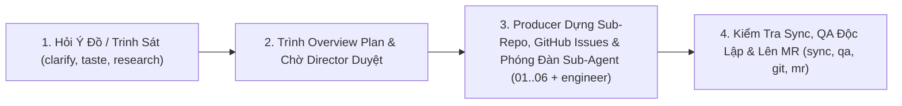

# Hướng Dẫn Vận Hành AI Game Studio Workspace

> **Phiên bản:** `1.1.0` | **Cập nhật:** `2026-11-21`
> Tài liệu thực chiến dành cho **Studio Director** (chủ dự án).
> Kiến trúc tổng thể xem thêm tại: [game-studio-architecture-blueprint.md](game-studio-architecture-blueprint.md).

---

## 1. 4 Quy Chuẩn Vận Hành Bất Biến Của Studio ([PREFLIGHT.md](../.agent/PREFLIGHT.md))

1. **Tách Biệt Tuyệt Đối Kho Workspace & Các Sub-Repo Dự Án (`Zero Project Data in Workspace Git`):**
   - Kho `games-studio-workspace` chỉ chứa hệ điều hành của Studio (`.agent/` skills, workflows, hooks, tools và `documents/`).
   - Thư mục `Projects/*` và `.agent-runs/*` bị khoá cứng trong [.gitignore](../.gitignore): **không một dòng code, tài liệu hay dữ liệu của bất kỳ dự án con nào được lọt lên Git của Workspace**. Mỗi dự án trong `Projects/<slug>/` là một Git Repository độc lập có remote riêng (`git@github.com:<owner>/<slug>.git`).
2. **Luồng Duyệt 2 Bước (`Interview -> Overview Plan -> Producer Tự Bẻ Chi Tiết Lên GitHub`):**
   - **Bước 1:** Với dự án mới hoặc tính năng còn mở, Agent phỏng vấn ngắn gọn (`clarify` + `taste`) để hiểu đúng ý đồ & gu của ông. Nếu dự án đã có sẵn thông tin, Agent cử `research` đi đọc khảo sát trước.
   - **Bước 2:** Agent xuất bản **Kế Hoạch Tổng Quan (`Overview Plan`)** ngắn gọn bằng tiếng Việt ra file Markdown tại `documents/<Tên dự án>/overview-plan.md` (theo [overview-plan.md](../.agent/workflows/overview-plan.md)) và **dừng lại gửi link chờ ông duyệt**. Sau khi ông gật đầu, tài liệu được khoá `status: locked` và **Producer** tự động tạo/cập nhật GitHub Repo, Milestones, bảng Project v2 cùng các **GitHub Issues** cho từng phòng ban mà không làm rối khung chat.
3. **Cấm 1 Agent Tự Ôm Việc (`Point >= 2` Bắt Buộc Chạy Đúng Đội Hình Phòng Ban):**
   - Chỉ `Point 1` (hỏi đáp hoặc sửa 1–2 dòng chữ) mới làm trực tiếp.
   - Từ `Point >= 2` trở lên, phiên chính bắt buộc giữ vai **`producer`** (không tự gõ code hay tự viết GDD hộ): cử `research` đi trinh sát trước $\rightarrow$ phát việc có gắn thẻ `ROLE: <phòng-ban>` cho các **Sub-agent chuyên môn** (`narrative`, `designer`, `balance`, `level`, `art-audio`, `architect`, `engineer`) $\rightarrow$ gọi Sub-agent **`qa` độc lập** hậu kiểm và tạo MR chuẩn (`mr`).
4. **Phân Tách Ngôn Ngữ Rõ Ràng & Điền Đủ Dữ Liệu Phòng Ban:**
   - **Tiếng Việt** *(giữ nguyên thuật ngữ chuyên môn, tên biến và mã ID tiếng Anh)*: Trò chuyện, bản `Overview Plan`, và **toàn bộ tài liệu sống của dự án** (`PROJECT.md`, `STYLE_ANCHOR.md`, `departments/MOC.md`, và `departments/01..06`). Mọi phòng ban có liên quan tới dự án đều phải có tài liệu thực chất — cấm bỏ trống thư mục rỗng.
   - **Tiếng Anh**: Toàn bộ `SKILL.md`, `workflows/*.md`, mã nguồn, comment 1 dòng, khoá JSON/YAML, Conventional Commits và tiêu đề 3 mục trong MR (`Name`, `Agent`, `Description`).



---

## 2. Cách Giao Việc Hàng Ngày (Ông Đóng Vai Game Director)

Ông luôn mở thư mục gốc `Games studio/` trên IDE và giao bài bằng tiếng Việt tự nhiên:

### 2.1. Mở một dự án mới trong `Projects/<slug>/`
> *"Tôi muốn làm một dự án mới tên `<Tên dự án>`, thể loại `<Thể loại>`, dùng `<Engine>`. Hãy phỏng vấn tôi các điểm cần chốt rồi lên Overview Plan cho tôi duyệt nhé."*

- Sau khi ông trả lời ngắn gọn và duyệt bản **Overview Plan**, `producer` sẽ tự động:
  1. Dựng sub-repo độc lập tại `Projects/<slug>/` (`bootstrap-game.mjs`).
  2. Chạy `gh-studio.mjs repo-init` tạo repo `private` riêng trên GitHub, gắn bộ nhãn 10 phòng ban (`Producer`, `Research`, `Narrative`, `Design`, `Balance`, `Level`, `Art-Audio`, `Architect`, `Engineer`, `QA`), tạo Milestone `M1-Foundation`, nối bảng GitHub Project v2 và bẻ các đầu việc thành **GitHub Issues**.
  3. Tách nhánh làm việc từ `main`, phóng dàn Sub-agent các phòng ban viết đầy đủ tài liệu tiếng Việt vào `departments/01..06` + `registry.yaml` + code nền tảng + test, đóng ngay các Issue đã hoàn tất (`gh-studio.mjs close`), mở MR chuẩn và chạy phiên `adversarial-review` độc lập (nếu `clean` tự động merge vào `main`; nếu trượt 3–4 phiên liên tiếp thì reject, báo ông và rà soát lại `overview-plan.md`).

### 2.2. Giao thêm tính năng / chỉnh sửa cho dự án đã có
> *"Vào dự án `<slug>`, phân tích hiện trạng rồi lên Overview Plan bổ sung hệ thống `<Tên tính năng>` cho tôi xem trước."*

- Producer sẽ cử `research` đọc hồ sơ hiện tại của `Projects/<slug>/`, trình **Overview Plan** gọn gàng, đợi ông chốt rồi mới tạo GitHub Issues và gọi các phòng ban liên quan vào làm đồng thời.

### 2.3. Khoá tài liệu chuẩn, Đồng bộ ngược & Dạy "Gu"
- **Khoá GDD đã duyệt:** *"Khoá `status: locked` cho bản GDD này nhé"* $\rightarrow$ Hook `write-guard.mjs` sẽ chặn và hỏi ý ông nếu về sau có Agent định sửa vào.
- **Sửa thông số lúc chơi thử:** *"Tăng tốc độ lướt thêm 20% rồi đồng bộ ngược lại tài liệu nhé"* $\rightarrow$ Tự động khớp lại cả `data/` $\leftrightarrow$ `registry.yaml` $\leftrightarrow$ GDD phòng ban $\leftrightarrow$ `MOC.md`.
- **Sửa lưng / Dạy Gu:** Nhắn rõ lưu riêng cho dự án (`STYLE_ANCHOR.md`) hay lưu thành luật chung toàn Studio (`DIRECTOR_PROFILE.md`).

---

## 3. Phụ Lục: Bộ Lệnh CLI Node.js Thuần Của Studio (`.agent/tools/*.mjs`)

```bash
# 1. Khởi tạo cấu trúc sub-repo dự án mới dưới Projects/<slug>/
node .agent/tools/bootstrap-game.mjs --slug <slug> --name "<Project Name>" --engine <Godot|Unity|Unreal|Web|Custom> --genre "<Genre>" --json

# 2. Tạo repo GitHub riêng (private), bộ nhãn 10 phòng ban, Milestone M1 & nối GitHub Project v2
node .agent/tools/gh-studio.mjs repo-init --repo <owner>/<slug> --project-dir Projects/<slug> --json

# 3. Tạo/Đóng GitHub Issue theo phòng ban & mở/merge MR chuẩn
node .agent/tools/gh-studio.mjs create --repo <owner>/<slug> --title "[Design] Core Loop GDD" --label "Design" --milestone "M1-Foundation" --body "..." --json
node .agent/tools/gh-studio.mjs close --repo <owner>/<slug> --issue 1 --body "Completed and verified" --json
node .agent/tools/gh-studio.mjs mr-create --repo <owner>/<slug> --base main --head feat/1-foundation --title "feat(core): build studio foundation" --body-file mr.md --json
node .agent/tools/gh-studio.mjs mr-merge --repo <owner>/<slug> --pr 1 --delete-branch --json

# 4. Kiểm tra đồng bộ toàn chuỗi (PROJECT.md, STYLE_ANCHOR.md, 01..06, registry.yaml, MOC.md)
node .agent/tools/check-sync.mjs --project Projects/<slug> --json

# 5. Kiểm định chuẩn toàn bộ SKILL.md & quét an toàn Git staging trước khi commit
node .agent/tools/validate-skills.mjs --strict --json
node .agent/tools/inspect-staging.mjs --repo Projects/<slug> --message "feat(core): add state machine" --json

# 6. Tóm tắt gọn log build/test dài thành danh sách lỗi trọng tâm
node .agent/tools/log-digest.mjs <path-to-log> --json
```
